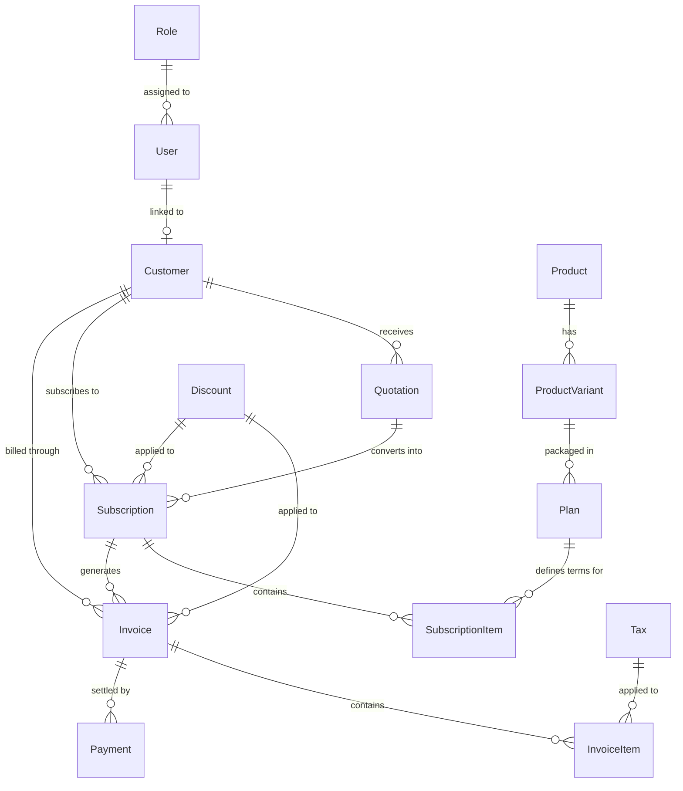

# Database Schema & Entity Specification

This document provides the foundational entity definitions, relationships, and data types for the **Brightloop Software Subscription Management System (SMS)**. 

Target Database: **PostgreSQL (Neon Database)**  
ORM: **Prisma ORM**

> [!NOTE]
> This document acts as an architectural blueprint for the backend developer. Actual database migrations will be performed via Prisma in the `backend/` module.

---

## 1. Entity-Relationship Overview

---

## 2. Core Entities & Attributes

### 2.1 User & Role
Manages administrative staff, sales agents, and authenticated customer portal accounts.

- **Role**
  - `id`: `String` (UUID / CUID, PK)
  - `name`: `String` (Unique: `ADMIN`, `STAFF`, `CUSTOMER`)
  - `description`: `String?`
  - `createdAt`: `DateTime`

- **User**
  - `id`: `String` (PK)
  - `email`: `String` (Unique, indexed)
  - `passwordHash`: `String` (Argon2 / bcrypt hash)
  - `firstName`: `String`
  - `lastName`: `String`
  - `roleId`: `String` (FK -> `Role.id`)
  - `isActive`: `Boolean` (Default: `true`)
  - `lastLoginAt`: `DateTime?`
  - `createdAt`: `DateTime`
  - `updatedAt`: `DateTime`

---

### 2.2 Customer
Represents business accounts or individuals who purchase subscriptions.

- **Customer**
  - `id`: `String` (PK, e.g. `cst_...`)
  - `userId`: `String?` (Unique FK -> `User.id`, for self-service portal access)
  - `companyName`: `String`
  - `contactName`: `String`
  - `email`: `String` (Indexed)
  - `phone`: `String?`
  - `billingAddress`: `Json` (street, city, state, postalCode, country)
  - `shippingAddress`: `Json?`
  - `taxId`: `String?` (e.g., VAT, GSTIN)
  - `currency`: `String` (Default: `USD`)
  - `status`: `Enum` (`ACTIVE`, `SUSPENDED`, `ARCHIVED`)
  - `createdAt`: `DateTime`
  - `updatedAt`: `DateTime`

---

### 2.3 Product, Variant & Plan
Defines software offerings, add-ons, seats, and recurring billing plans.

- **Product**
  - `id`: `String` (PK)
  - `name`: `String` (e.g. "Brightloop Analytics Suite")
  - `slug`: `String` (Unique)
  - `description`: `String?`
  - `isActive`: `Boolean` (Default: `true`)
  - `createdAt`: `DateTime`
  - `updatedAt`: `DateTime`

- **ProductVariant**
  - `id`: `String` (PK)
  - `productId`: `String` (FK -> `Product.id`)
  - `name`: `String` (e.g. "Standard Seat", "Enterprise Add-on", "Storage Block")
  - `sku`: `String` (Unique)
  - `unit`: `String` (e.g. "license", "gb", "agent")
  - `unitPriceInCents`: `Int` (Base catalog unit price in cents)
  - `isActive`: `Boolean`

- **Plan**
  - `id`: `String` (PK)
  - `variantId`: `String` (FK -> `ProductVariant.id`)
  - `name`: `String` (e.g. "Pro Annual", "Starter Monthly")
  - `billingInterval`: `Enum` (`MONTHLY`, `QUARTERLY`, `SEMI_ANNUAL`, `ANNUAL`)
  - `intervalCount`: `Int` (Default: `1`)
  - `priceInCents`: `Int` (Billing price in cents)
  - `currency`: `String` (Default: `USD`)
  - `trialDays`: `Int` (Default: `0`)
  - `isActive`: `Boolean` (Default: `true`)

---

### 2.4 Quotation
Sales proposals and agreements generated for prospective or existing customers before active subscription.

- **Quotation**
  - `id`: `String` (PK)
  - `quotationNumber`: `String` (Unique, e.g. `QT-2026-0001`)
  - `customerId`: `String` (FK -> `Customer.id`)
  - `status`: `Enum` (`DRAFT`, `SENT`, `ACCEPTED`, `REJECTED`, `EXPIRED`)
  - `subtotalInCents`: `Int`
  - `taxInCents`: `Int`
  - `discountInCents`: `Int`
  - `totalInCents`: `Int`
  - `validUntil`: `DateTime`
  - `termsAndConditions`: `String?`
  - `convertedSubscriptionId`: `String?` (FK -> `Subscription.id`)
  - `createdAt`: `DateTime`
  - `updatedAt`: `DateTime`

---

### 2.5 Subscription & SubscriptionItem
Recurring contracts associated with customers.

- **Subscription**
  - `id`: `String` (PK)
  - `customerId`: `String` (FK -> `Customer.id`)
  - `quotationId`: `String?` (FK -> `Quotation.id`)
  - `status`: `Enum` (`TRIALING`, `ACTIVE`, `PAST_DUE`, `PAUSED`, `CANCELED`, `EXPIRED`)
  - `currentPeriodStart`: `DateTime`
  - `currentPeriodEnd`: `DateTime`
  - `cancelAtPeriodEnd`: `Boolean` (Default: `false`)
  - `canceledAt`: `DateTime?`
  - `billingCycleAnchor`: `DateTime`
  - `currency`: `String`
  - `discountId`: `String?` (FK -> `Discount.id`)
  - `metadata`: `Json?`
  - `createdAt`: `DateTime`
  - `updatedAt`: `DateTime`

- **SubscriptionItem**
  - `id`: `String` (PK)
  - `subscriptionId`: `String` (FK -> `Subscription.id`, Cascade Delete)
  - `planId`: `String` (FK -> `Plan.id`)
  - `quantity`: `Int` (Default: `1`)
  - `unitPriceInCents`: `Int` (Locked price at time of subscription)
  - `createdAt`: `DateTime`
  - `updatedAt`: `DateTime`

---

### 2.6 Invoice & InvoiceItem
Generated billing statements and recurring charges.

- **Invoice**
  - `id`: `String` (PK)
  - `invoiceNumber`: `String` (Unique, e.g. `INV-2026-0001`)
  - `customerId`: `String` (FK -> `Customer.id`)
  - `subscriptionId`: `String?` (FK -> `Subscription.id`)
  - `status`: `Enum` (`DRAFT`, `OPEN`, `PAID`, `UNCOLLECTIBLE`, `VOID`)
  - `subtotalInCents`: `Int`
  - `taxInCents`: `Int`
  - `discountInCents`: `Int`
  - `totalInCents`: `Int`
  - `amountPaidInCents`: `Int` (Default: `0`)
  - `amountDueInCents`: `Int`
  - `currency`: `String`
  - `dueDate`: `DateTime`
  - `paidAt`: `DateTime?`
  - `pdfUrl`: `String?`
  - `createdAt`: `DateTime`
  - `updatedAt`: `DateTime`

- **InvoiceItem**
  - `id`: `String` (PK)
  - `invoiceId`: `String` (FK -> `Invoice.id`, Cascade Delete)
  - `description`: `String`
  - `quantity`: `Int`
  - `unitPriceInCents`: `Int`
  - `totalInCents`: `Int`
  - `taxId`: `String?` (FK -> `Tax.id`)

---

### 2.7 Tax & Discount
Calculation entities for regional taxation and promotion rules.

- **Tax**
  - `id`: `String` (PK)
  - `name`: `String` (e.g. "Standard VAT", "State Sales Tax")
  - `percentage`: `Decimal` (Precision: 5, Scale: 2, e.g. `18.00` for 18%)
  - `jurisdiction`: `String` (e.g. "US-CA", "EU-FR", "IN")
  - `isActive`: `Boolean` (Default: `true`)

- **Discount**
  - `id`: `String` (PK)
  - `code`: `String` (Unique, e.g. `ANNUAL20`)
  - `type`: `Enum` (`PERCENTAGE`, `FIXED_AMOUNT`)
  - `value`: `Int` (Percentage in basis points e.g. 2000 = 20%, or fixed cents e.g. 5000 = $50.00)
  - `currency`: `String?` (Required for fixed amount discounts)
  - `validFrom`: `DateTime`
  - `validTo`: `DateTime?`
  - `maxRedemptions`: `Int?`
  - `timesRedeemed`: `Int` (Default: `0`)
  - `isActive`: `Boolean` (Default: `true`)

---

### 2.8 Payment
Financial transactions reconciling open invoices.

- **Payment**
  - `id`: `String` (PK, e.g. `pay_...`)
  - `invoiceId`: `String` (FK -> `Invoice.id`)
  - `paymentMethod`: `Enum` (`CREDIT_CARD`, `BANK_TRANSFER`, `ACH`, `MANUAL`)
  - `transactionReference`: `String?` (External payment gateway ID or check reference)
  - `amountInCents`: `Int`
  - `currency`: `String`
  - `status`: `Enum` (`PENDING`, `SUCCEEDED`, `FAILED`, `REFUNDED`)
  - `failureReason`: `String?`
  - `paidAt`: `DateTime?`
  - `createdAt`: `DateTime`

---

## 3. Recommended PostgreSQL Indexes

1. `Customer(email)`
2. `Subscription(customerId, status)`
3. `Subscription(currentPeriodEnd)` (Critical for BullMQ automated billing cron)
4. `Invoice(customerId, status)`
5. `Invoice(dueDate)` (Critical for overdue aging queries)
6. `Payment(invoiceId, status)`

