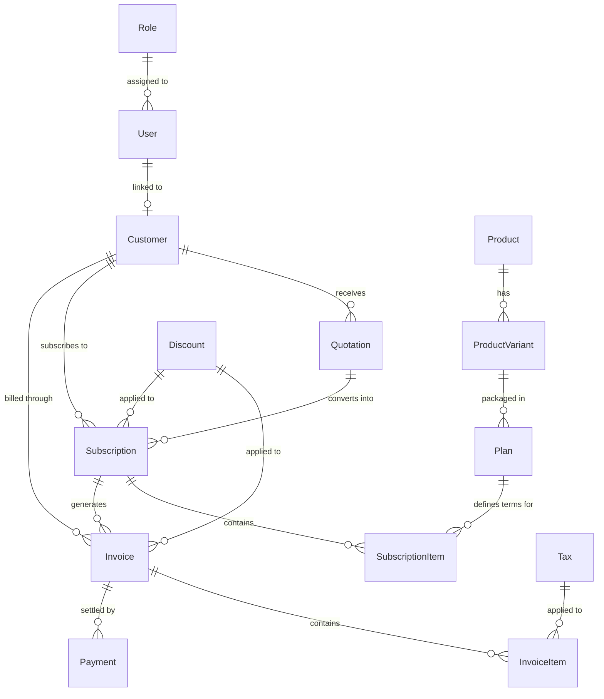

# Database Schema & Entity Specification

This document provides the foundational entity definitions, relationships, and data types for the **Brightloop Software Subscription Management System (SMS)**. 

Target Database: **PostgreSQL (Neon Database)**  
ORM: **Prisma ORM**

> [!NOTE]
> This document acts as an architectural blueprint for the backend developer. Actual database migrations will be performed via Prisma in the `backend/` module.

---

## 1. Entity-Relationship Overview

---

## 2. Core Entities & Attributes

### 2.1 User & Role
Manages administrative staff, sales agents, and authenticated customer portal accounts.

- **Role**
  - `id`: `String` (UUID / CUID, PK)
  - `name`: `String` (Unique: `ADMIN`, `STAFF`, `CUSTOMER`)
  - `description`: `String?`
  - `createdAt`: `DateTime`

- **User**
  - `id`: `String` (PK)
  - `email`: `String` (Unique, indexed)
  - `passwordHash`: `String` (Argon2 / bcrypt hash)
  - `firstName`: `String`
  - `lastName`: `String`
  - `roleId`: `String` (FK -> `Role.id`)
  - `isActive`: `Boolean` (Default: `true`)
  - `lastLoginAt`: `DateTime?`
  - `createdAt`: `DateTime`
  - `updatedAt`: `DateTime`

---

### 2.2 Customer
Represents business accounts or individuals who purchase subscriptions.

- **Customer**
  - `id`: `String` (PK, e.g. `cst_...`)
  - `userId`: `String?` (Unique FK -> `User.id`, for self-service portal access)
  - `customerCode`: `String` (Unique, indexed, human-readable e.g. `CUST-XXXXXX`)
  - `customerType`: `Enum` (`INDIVIDUAL`, `COMPANY`, default: `COMPANY`, indexed)
  - `firstName`: `String?` (required for `INDIVIDUAL`)
  - `lastName`: `String?`
  - `companyName`: `String?` (required for `COMPANY`)
  - `email`: `String` (Unique, indexed contact email)
  - `phone`: `String?`
  - `alternatePhone`: `String?`
  - `billingAddress`: `String?`
  - `billingCity`: `String?`
  - `billingState`: `String?`
  - `billingPostalCode`: `String?`
  - `billingCountry`: `String?`
  - `taxNumber`: `String?` (e.g. VAT, GSTIN)
  - `notes`: `String?`
  - `currency`: `String` (Default: `USD`)
  - `isActive`: `Boolean` (Default: `true`, indexed)
  - `status`: `Enum` (`ACTIVE`, `SUSPENDED`, `ARCHIVED`)
  - `createdAt`: `DateTime`
  - `updatedAt`: `DateTime`

---

### 2.3 Product, Variant & Plan
Defines software offerings, add-ons, seats, and recurring billing plans.

- **ProductType**
  - Enum values: `SOFTWARE`, `SERVICE`, `SUBSCRIPTION`, `ADD_ON`

- **Product**
  - `id`: `String` (PK, CUID)
  - `name`: `String` (Indexed, e.g. "Brightloop Analytics Suite")
  - `slug`: `String` (Unique, e.g. "brightloop-analytics")
  - `description`: `String?`
  - `type`: `ProductType` (Default: `SOFTWARE`, Indexed)
  - `basePrice`: `Decimal(12, 2)` (Base selling price, default: `0.00`)
  - `costPrice`: `Decimal(12, 2)?` (Optional unit cost price)
  - `isActive`: `Boolean` (Default: `true`, Indexed)
  - `createdAt`: `DateTime` (Default: `now()`)
  - `updatedAt`: `DateTime`
  - Composite Index: `@@index([createdAt, id])` for deterministic cursor pagination

- **ProductVariant**
  - `id`: `String` (PK, CUID)
  - `productId`: `String` (FK -> `Product.id`, Indexed)
  - `name`: `String` (Unique per product, e.g. "Premium Support")
  - `sku`: `String` (Unique, e.g. "SKU-ANL-SUPP")
  - `description`: `String?`
  - `unit`: `String` (Default: `"seat"`)
  - `unitPriceInCents`: `Int` (Default: `0`, preserved for Plan relations)
  - `additionalPrice`: `Decimal(12, 2)` (Additional variant price, default: `0.00`)
  - `isActive`: `Boolean` (Default: `true`, Indexed)
  - `createdAt`: `DateTime` (Default: `now()`)
  - `updatedAt`: `DateTime`
  - Composite Index: `@@index([createdAt, id])` for deterministic cursor pagination

- **BillingCycle**
  - `MONTHLY`, `QUARTERLY`, `HALF_YEARLY`, `YEARLY`, `CUSTOM`

- **CustomBillingUnit**
  - `DAYS`, `WEEKS`, `MONTHS`, `YEARS`

- **Plan**
  - `id`: `String` (PK, cuid)
  - `productId`: `String` (FK -> `Product.id`, Cascade Delete, Indexed)
  - `name`: `String` (Plan display name, e.g. "Pro Annual", "Starter Monthly")
  - `description`: `String?`
  - `billingCycle`: `Enum` (`BillingCycle`, Default: `MONTHLY`, Indexed)
  - `customDuration`: `Int?` (Required when `billingCycle` is `CUSTOM`)
  - `customDurationUnit`: `Enum` (`CustomBillingUnit?`)
  - `price`: `Decimal(12, 2)` (Recurring subscription price snapshot = basePrice + selected active variants)
  - `setupFee`: `Decimal(12, 2)` (One-time upfront fee, Default: `0.00`)
  - `currency`: `String` (Default: `"INR"`)
  - `trialDays`: `Int` (Default: `0`)
  - `isActive`: `Boolean` (Default: `true`, Indexed)
  - `variantId`: `String?` (FK -> `ProductVariant.id`, SetNull on delete, legacy support)
  - `billingInterval`: `Enum` (`BillingInterval`, Default: `MONTHLY`, legacy support)
  - `intervalCount`: `Int` (Default: `1`)
  - `priceInCents`: `Int` (Default: `0`)
  - Composite Index: `@@index([createdAt, id])` for deterministic cursor pagination

> **Pricing Architecture Decision (Snapshot vs Dynamic Calculation):**
> Plan `price` is stored as an authoritative snapshot upon creation and update rather than purely derived at runtime. This guarantees historical financial consistency for active and renewing subscriptions if underlying base product prices or variant additional prices change in the future. Price validity is strictly enforced at creation/update via backend computation: $\text{Plan Price} = \text{Base Product Price} + \sum \text{Selected Active Variant Prices}$.

- **PlanVariant** (Join Entity for Plan & ProductVariant)
  - `id`: `String` (PK, cuid)
  - `planId`: `String` (FK -> `Plan.id`, Cascade Delete, Indexed)
  - `variantId`: `String` (FK -> `ProductVariant.id`, Cascade Delete, Indexed)
  - `createdAt`: `DateTime` (Default: `now()`)
  - Unique Constraint: `@@unique([planId, variantId])`

---

### 2.4 Quotation & QuotationItem
Sales proposals, agreements, and price quotations generated for prospective or existing customers before active subscription.

- **QuotationStatus**
  - Enum values: `DRAFT`, `SENT`, `ACCEPTED`, `REJECTED`, `EXPIRED`, `CONVERTED`

- **Quotation**
  - `id`: `String` (PK, CUID)
  - `quotationNumber`: `String` (Unique, e.g. `QUO-000001`, Indexed)
  - `customerId`: `String` (FK -> `Customer.id`, Cascade Delete, Indexed)
  - `quotationDate`: `DateTime` (Default: `now()`)
  - `validUntil`: `DateTime`
  - `status`: `QuotationStatus` (Default: `DRAFT`, Indexed)
  - `currency`: `String` (Default: `"INR"`)
  - `subtotal`: `Decimal(12, 2)` (Default: `0.00`)
  - `discountAmount`: `Decimal(12, 2)` (Default: `0.00`)
  - `taxAmount`: `Decimal(12, 2)` (Default: `0.00`)
  - `grandTotal`: `Decimal(12, 2)` (Default: `0.00`)
  - `subtotalInCents`: `Int` (Default: `0`, legacy compatibility)
  - `taxInCents`: `Int` (Default: `0`, legacy compatibility)
  - `discountInCents`: `Int` (Default: `0`, legacy compatibility)
  - `totalInCents`: `Int` (Default: `0`, legacy compatibility)
  - `notes`: `String?`
  - `termsAndConditions`: `String?`
  - `convertedSubscriptionId`: `String?` (FK -> `Subscription.id`)
  - `createdAt`: `DateTime` (Default: `now()`)
  - `updatedAt`: `DateTime`
  - Composite Index: `@@index([createdAt, id])` for deterministic cursor pagination

- **QuotationItem**
  - `id`: `String` (PK, CUID)
  - `quotationId`: `String` (FK -> `Quotation.id`, Cascade Delete, Indexed)
  - `productId`: `String` (FK -> `Product.id`, Indexed)
  - `planId`: `String?` (FK -> `Plan.id`, Indexed)
  - `quantity`: `Int` (Default: `1`)
  - `unitPrice`: `Decimal(12, 2)` (Authoritative price snapshot)
  - `setupFee`: `Decimal(12, 2)` (Default: `0.00`)
  - `discountAmount`: `Decimal(12, 2)` (Default: `0.00`)
  - `taxAmount`: `Decimal(12, 2)` (Default: `0.00`)
  - `taxRate`: `Decimal(5, 2)` (Default: `0.00`)
  - `lineTotal`: `Decimal(12, 2)` (Calculated line total snapshot)
  - `selectedVariants`: `Json?` (Array of selected variant snapshots)
  - `createdAt`: `DateTime` (Default: `now()`)
  - `updatedAt`: `DateTime`
  - Composite Index: `@@index([createdAt, id])` for deterministic cursor pagination

---

### 2.5 Subscription & SubscriptionItem
Recurring contracts associated with customers.

- **SubscriptionStatus**
  - Enum values: `PENDING`, `TRIALING`, `ACTIVE`, `PAST_DUE`, `PAUSED`, `CANCELED`, `EXPIRED`

- **Subscription**
  - `id`: `String` (PK, CUID)
  - `subscriptionNumber`: `String` (Unique, e.g. `SUB-000001`, Indexed)
  - `customerId`: `String` (FK -> `Customer.id`, Cascade Delete, Indexed)
  - `planId`: `String?` (FK -> `Plan.id`, Indexed)
  - `quotationId`: `String?` (Unique FK -> `Quotation.id`, Indexed)
  - `status`: `SubscriptionStatus` (Default: `PENDING`, Indexed)
  - `startDate`: `DateTime` (Default: `now()`)
  - `currentPeriodStart`: `DateTime`
  - `currentPeriodEnd`: `DateTime`
  - `nextBillingDate`: `DateTime?`
  - `endDate`: `DateTime?`
  - `billingCycle`: `BillingCycle` (Default: `MONTHLY`)
  - `recurringPrice`: `Decimal(12, 2)` (Default: `0.00`)
  - `setupFee`: `Decimal(12, 2)` (Default: `0.00`)
  - `currency`: `String` (Default: `"INR"`)
  - `cancelAtPeriodEnd`: `Boolean` (Default: `false`)
  - `canceledAt`: `DateTime?`
  - `cancellationReason`: `String?`
  - `pausedAt`: `DateTime?`
  - `resumedAt`: `DateTime?`
  - `billingCycleAnchor`: `DateTime`
  - `discountId`: `String?` (FK -> `Discount.id`)
  - `metadata`: `Json?`
  - `createdAt`: `DateTime` (Default: `now()`)
  - `updatedAt`: `DateTime`
  - Composite Index: `@@index([createdAt, id])` for deterministic cursor pagination

- **SubscriptionItem**
  - `id`: `String` (PK, CUID)
  - `subscriptionId`: `String` (FK -> `Subscription.id`, Cascade Delete, Indexed)
  - `planId`: `String` (FK -> `Plan.id`, Indexed)
  - `quantity`: `Int` (Default: `1`)
  - `unitPrice`: `Decimal(12, 2)` (Default: `0.00`, locked price snapshot)
  - `lineTotal`: `Decimal(12, 2)` (Default: `0.00`)
  - `selectedVariants`: `Json?` (Array of selected variant snapshots)
  - `unitPriceInCents`: `Int` (Default: `0`, legacy compatibility)
  - `createdAt`: `DateTime` (Default: `now()`)
  - `updatedAt`: `DateTime`
  - Composite Index: `@@index([createdAt, id])` for deterministic cursor pagination

---

### 2.6 Invoice & InvoiceItem
Generated billing statements and recurring charges.

- **Invoice**
  - `id`: `String` (PK)
  - `invoiceNumber`: `String` (Unique, e.g. `INV-2026-0001`)
  - `customerId`: `String` (FK -> `Customer.id`)
  - `subscriptionId`: `String?` (FK -> `Subscription.id`)
  - `status`: `Enum` (`DRAFT`, `OPEN`, `PAID`, `UNCOLLECTIBLE`, `VOID`)
  - `subtotalInCents`: `Int`
  - `taxInCents`: `Int`
  - `discountInCents`: `Int`
  - `totalInCents`: `Int`
  - `amountPaidInCents`: `Int` (Default: `0`)
  - `amountDueInCents`: `Int`
  - `currency`: `String`
  - `dueDate`: `DateTime`
  - `paidAt`: `DateTime?`
  - `pdfUrl`: `String?`
  - `createdAt`: `DateTime`
  - `updatedAt`: `DateTime`

- **InvoiceItem**
  - `id`: `String` (PK)
  - `invoiceId`: `String` (FK -> `Invoice.id`, Cascade Delete)
  - `description`: `String`
  - `quantity`: `Int`
  - `unitPriceInCents`: `Int`
  - `totalInCents`: `Int`
  - `taxId`: `String?` (FK -> `Tax.id`)

---

### 2.7 Tax & Discount
Calculation entities for regional taxation and promotion rules.

- **Tax**
  - `id`: `String` (PK)
  - `name`: `String` (e.g. "Standard VAT", "State Sales Tax")
  - `percentage`: `Decimal` (Precision: 5, Scale: 2, e.g. `18.00` for 18%)
  - `jurisdiction`: `String` (e.g. "US-CA", "EU-FR", "IN")
  - `isActive`: `Boolean` (Default: `true`)

- **Discount**
  - `id`: `String` (PK)
  - `code`: `String` (Unique, e.g. `ANNUAL20`)
  - `type`: `Enum` (`PERCENTAGE`, `FIXED_AMOUNT`)
  - `value`: `Int` (Percentage in basis points e.g. 2000 = 20%, or fixed cents e.g. 5000 = $50.00)
  - `currency`: `String?` (Required for fixed amount discounts)
  - `validFrom`: `DateTime`
  - `validTo`: `DateTime?`
  - `maxRedemptions`: `Int?`
  - `timesRedeemed`: `Int` (Default: `0`)
  - `isActive`: `Boolean` (Default: `true`)

---

### 2.8 Payment
Financial transactions reconciling open invoices.

- **Payment**
  - `id`: `String` (PK, e.g. `pay_...`)
  - `invoiceId`: `String` (FK -> `Invoice.id`)
  - `paymentMethod`: `Enum` (`CREDIT_CARD`, `BANK_TRANSFER`, `ACH`, `MANUAL`)
  - `transactionReference`: `String?` (External payment gateway ID or check reference)
  - `amountInCents`: `Int`
  - `currency`: `String`
  - `status`: `Enum` (`PENDING`, `SUCCEEDED`, `FAILED`, `REFUNDED`)
  - `failureReason`: `String?`
  - `paidAt`: `DateTime?`
  - `createdAt`: `DateTime`

---

## 3. Recommended PostgreSQL Indexes

1. `Customer(email)`
2. `Subscription(customerId, status)`
3. `Subscription(currentPeriodEnd)` (Critical for BullMQ automated billing cron)
4. `Invoice(customerId, status)`
5. `Invoice(dueDate)` (Critical for overdue aging queries)
6. `Payment(invoiceId, status)`

